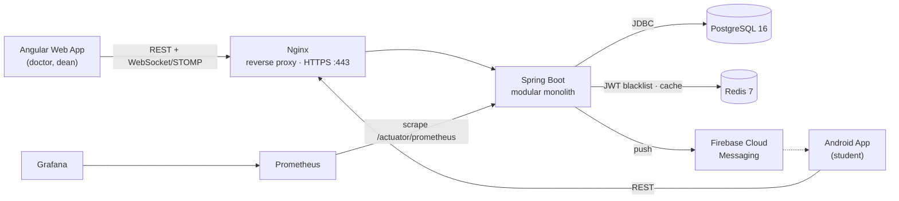
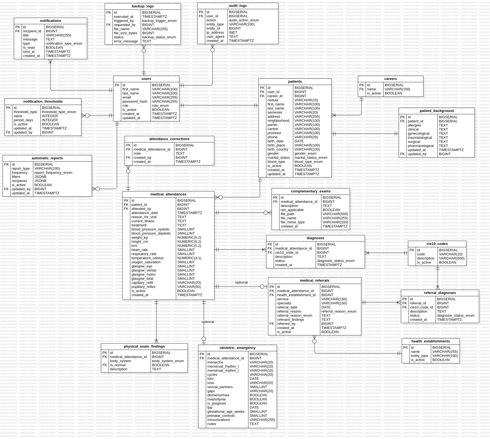

<p align="center"><strong>English</strong> · <a href="README.es.md">Español</a></p>

<div align="center">
    <h1>MEDISTA</h1>
    <strong> Healthcare Management System</strong>
    
    <br/><br/>
    
    
    
    
    
    
    <br/>
    
    
    <br/>
    
    
    
    
    
    
    
    
    <br/>
    
    
    
    
    <br/>
    
    
    
    
    
    <br/>
    
    
    
    <br/>
    
    
    <br/>
    
    
    
    
    
    <br/>
    
    
    
    
    <br/>
    
    
    
    <br/><br/>
</div>

---

## Overview

MEDISTA is a healthcare management system that fully digitizes the clinical care process of educational institutions, which today runs mostly by hand on paper forms. The system includes a web platform for medical and administrative staff, and a mobile app for students.

It is designed for the medical department of any educational institution, from a small one with a single doctor to one that serves thousands of students. The goal is to replace the paper form, centralize the clinical record, provide data for decision-making and comply with Ecuadorian health data protection regulations.

| Role | Platform | What they do |
| ---- | -------- | ------------ |
| **Doctor** | Web | Registers patients, creates consultations and referrals, reviews records and receives clinical alerts. |
| **Dean / Administrator** | Web | Sees **aggregated** dashboards and reports (never individual records), manages users and catalogs. |
| **Student** | Mobile app | Views their own consultations in read-only mode and receives notifications. |

> **Status:** in development. The requirements and design phase is closed (see [`docs/`](docs/)); implementation moves forward module by module, starting with M7 (Security) and M1 (Patients).

## Screenshots

Screenshots will be added as the web panel gets navigable screens.

## Key Features

- **Digitized consultation form** — reason for visit, medical history, vital signs, physical exam by system, diagnosis and treatment in a single flow.
- **Automatic calculations** — BMI (weight / height²), Glasgow total and patient age; they are persisted so the record does not change if a formula changes.
- **ICD-10 diagnosis** — autocomplete search over 14,000+ codes (fuzzy search with `pg_trgm`), marked as presumptive or definitive.
- **Conditional obstetric section** — shown only when it applies to the patient.
- **Cumulative medical history** — what is recorded in one consultation is preloaded in the next ones.
- **Immutable consultations** — a saved consultation cannot be edited or deleted; it is corrected with attached notes, as required by the MSP (Ministry of Public Health).
- **Medical referrals as PDF** — in the same format as the department's paper form.
- **Clinical record** — patient timeline and vital sign trend charts.
- **Dashboard with cross filters** — program, semester, term, gender, age and diagnosis combined; export to PDF and Excel.
- **Smart alerts** — frequent patients, possible outbreaks and demand spikes, with configurable thresholds.
- **Full audit trail** — immutable record of who did what, when and from where.

## Architecture

**Modular monolith.** A single Spring Boot application organized *module-first*: each module (M1–M8) is a package with two zones.

- `api/` — the module's public contract (services and DTOs). It is the only part other modules may use.
- `internal/` — the implementation (controllers, entities, repositories, mappers). No other module touches it.

This keeps modules decoupled and, if it is ever needed, they can be extracted into independent services without rewriting the system.



Everything runs with Docker Compose on the institution's local server. Only Nginx is exposed to the network (port 443); PostgreSQL and Redis stay inside the Docker network. Details are in the [component diagram](docs/03-DESIGN/COMPONENT_DIAGRAM.md) and the [deployment diagram](docs/03-DESIGN/DEPLOYMENT_DIAGRAM.md).

## Tech Stack

✅ = already integrated in the code · 🕓 = defined in the design, not yet integrated

### Backend

| Technology | Version | Purpose | Status |
| ---------- | ------- | ------- | ------ |
| Java | 21 LTS | Language | ✅ |
| Spring Boot | 4.0.6 | Base framework (Web, Validation, WebSocket) | ✅ |
| Spring Data JPA + Hibernate | 7 | Persistence | ✅ |
| Hibernate Envers | 7 | Entity revision history (`*_aud`) | ✅ |
| Flyway | 11 | Versioned database migrations | ✅ |
| MapStruct | 1.5.5 | Entity ↔ DTO mapping | ✅ |
| Lombok | 1.18.42 | Boilerplate reduction | ✅ |
| SpringDoc OpenAPI | 3 | Interactive API documentation | 🕓 |

### Web Frontend

| Technology | Version | Purpose | Status |
| ---------- | ------- | ------- | ------ |
| Angular (standalone) | 20 | SPA framework | ✅ |
| Angular Material + CDK | 20 | Accessible components | ✅ |
| Tailwind CSS | 4 | Utility styles (Vite plugin) | ✅ |
| RxJS | 7.8 | Reactive programming | ✅ |
| TypeScript | 5.8 | Language | ✅ |
| NgRx Signals | 20 | Application state | 🕓 |
| Chart.js | 4 | Dashboard charts | 🕓 |

### Mobile App

| Technology | Version | Purpose | Status |
| ---------- | ------- | ------- | ------ |
| Kotlin (native Android) | — | Student app, distributed as an APK | 🕓 |
| Android | 8.0+ (API 26) | Minimum platform | 🕓 |
| Firebase Cloud Messaging | HTTP v1 | Push notifications | 🕓 |

### Database

| Technology | Version | Purpose | Status |
| ---------- | ------- | ------- | ------ |
| PostgreSQL | 16 | Main database | ✅ |
| pgcrypto | — | Field-level encryption of clinical data | ✅ |
| pg_trgm | — | Fuzzy search of patients and ICD-10 | ✅ |
| Redis | 7 | JWT blacklist and cache | ✅ |

### Security

| Technology | Version | Purpose | Status |
| ---------- | ------- | ------- | ------ |
| Spring Security | 7 | Authentication and role-based authorization | ✅ |
| JJWT | 0.12.6 | Issuing and validating JWTs | ✅ |
| BCrypt | cost 12 | Password hashing | ✅ |
| Bucket4j | 8.10.1 | Login attempt limit per IP | ✅ |
| Jasypt | 3.0.5 | Encryption of configuration properties | ✅ |
| HMAC-SHA256 | — | Chained integrity of the audit log | 🕓 |

### Reports

| Technology | Version | Purpose | Status |
| ---------- | ------- | ------- | ------ |
| JasperReports | 7 | Consultation and referral PDFs | 🕓 |
| Apache POI | 5 | Excel export | 🕓 |

### Observability

| Technology | Version | Purpose | Status |
| ---------- | ------- | ------- | ------ |
| Spring Boot Actuator | 4.0 | Health checks and metrics | ✅ |
| Micrometer + Prometheus | — | Metrics collection | ✅ |
| Grafana | — | Monitoring dashboards | ✅ |

## System Modules

| Module | Description |
| ------ | ----------- |
| **M1 — Patient Management** | Registration, search (national ID, first names, last names) and editing of the student's personal data. |
| **M2 — Medical Care** | The full clinical form: the heart of the system. Immutable consultations with correction notes. |
| **M3 — Medical Referral** | Referral to another health facility, with a downloadable PDF in the institutional format. |
| **M4 — Clinical Record** | Patient timeline, vital sign trends and recurring diagnoses. |
| **M5 — Dashboard and Reports** | Indicators with cross filters and reports exportable to PDF/Excel, manual or automatic. |
| **M6 — Notifications** | Alerts in the system inbox, by email and mobile push, with configurable thresholds. |
| **M7 — Security and Audit** | Login, role-based access control, expiring sessions and an immutable audit log. |
| **M8 — Administration** | Users, catalogs (programs, ICD-10, facilities), thresholds, automatic reports and backups. |

Each module has its use cases in [`docs/02-REQUIREMENTS/USE-CASES/`](docs/02-REQUIREMENTS/USE-CASES/). Appointment scheduling is left as a future module.

## Data Model

<div align="center">
    
</div>

19 tables in PostgreSQL 16, created with Flyway migrations (`backend/src/main/resources/db/migration/`). The main entities:

| Group | Tables |
| ----- | ------ |
| Identity and security | `users`, `audit_logs`, `backup_logs` |
| Patients (M1) | `patients`, `patient_background`, `careers` |
| Medical care (M2) | `medical_attendances`, `physical_exam_findings`, `obstetric_emergency`, `complementary_exams`, `diagnoses`, `attendance_corrections`, `cie10_codes` |
| Referrals (M3) | `medical_referrals`, `referral_diagnoses`, `health_establishments` |
| Notifications (M6) | `notifications`, `notification_thresholds` |
| Administration (M8) | `automatic_reports` |

Key principles:

- **Identity separated from clinical data** — `users` only authenticates; clinical data lives in `patients` ([ADR-001](docs/03-DESIGN/ADR/ADR-001_SEPARATION-USERS-PATIENTS.md)).
- **Soft delete** — no clinical record is ever physically deleted; it is marked `is_active = false`.
- **Persisted calculated fields** — BMI and Glasgow are stored so the record stays exact ([ADR-005](docs/03-DESIGN/ADR/ADR-005_PERSISTENCE-CALCULATED-FILES.md)).
- **Files outside the database** — attachments go to the file system; the database only stores the path ([ADR-007](docs/03-DESIGN/ADR/ADR-007_FILE-STORAGE-SYSTEM-FILE.md)).
- **Automatic auditing** — Hibernate Envers generates a `*_aud` table for every audited entity.

Column, constraint and enum details are in [`DATA_MODEL.md`](docs/03-DESIGN/DATA_MODEL.md).

## Prerequisites

| Tool | Version | What for |
| ---- | ------- | -------- |
| Git | 2.x | Cloning the repository |
| Docker + Docker Compose | Docker 24+ / Compose v2 | PostgreSQL, Redis, Prometheus and Grafana |
| JDK | 21 (Temurin recommended) | Building and running the backend |
| Node.js | 20.19+, 22.12+ or 24 | Web frontend (Angular 20 requirement) |
| npm | 10+ | Frontend dependencies |

You don't need to install Maven: the backend ships with the `./mvnw` wrapper.

## Installation and Setup

Clone the repository and create your environment file from the template:

```bash
git clone https://github.com/zhunio2003/medista.git
cd medista
cp .env.example .env   # fill in the credentials; .env is never committed
```

| Variable | Where it is used |
| -------- | ---------------- |
| `POSTGRES_DB`, `POSTGRES_USER`, `POSTGRES_PASS` | Database and backend |
| `REDIS_PASSWORD` | Redis and backend |
| `GRAFANA_PASSWORD` | Grafana `admin` user |
| `JWT_SECRET`, `JASYPT_PASSWORD` | Backend — **required in production** (the defaults in `application.yml` are for development only) |

### Backend

Start only the database and Redis with Docker, and run the backend on your machine:

```bash
docker compose up -d postgres_medista redis_medista

cd backend
set -a; source ../.env; set +a          # load the variables from .env
DB_HOST=localhost DB_PORT=5433 \
REDIS_HOST=localhost REDIS_PORT=6380 \
./mvnw spring-boot:run
```

Flyway applies the migrations on startup. The API is available at `http://localhost:8000/api` and the health check at `http://localhost:8000/api/actuator/health`.

### Web Frontend

```bash
cd frontend/web
npm ci
npm start
```

Open `http://localhost:4200`.

### Mobile App

The Android app (Kotlin) is not in the repository yet. This section will be completed once the project is created in `mobile/`.

### Docker Compose

To start the whole environment with a single command:

```bash
docker compose up -d --build
```

| Service | Container | Port on your machine |
| ------- | --------- | -------------------- |
| Backend | `backend_medista` | `8000` |
| PostgreSQL | `postgres_medista` | `5433` |
| Redis | `redis_medista` | `6380` |
| Prometheus | `prometheus_medista` | `9091` |
| Grafana | `grafana_medista` | `3001` |

To shut it down: `docker compose down` (add `-v` only if you also want to delete the data).

## Project Structure

```
medista/
├── backend/                        # REST API — Spring Boot (Java 21)
│   └── src/
│       ├── main/java/ec/insti/medista/
│       │   ├── config/             # cross-cutting configuration (security, etc.)
│       │   ├── common/             # shared DTOs, exceptions and auditing
│       │   ├── exception/          # global error handler
│       │   ├── security/           # M7 — authentication, JWT, auditing
│       │   ├── patient/            # M1 — patients and medical history
│       │   └── administration/     # M8 — catalogs
│       │       ├── api/            #   module's public contract
│       │       └── internal/       #   private implementation
│       ├── main/resources/
│       │   ├── application.yml
│       │   └── db/migration/       # Flyway migrations (V1…V25)
│       └── test/                   # unit and integration tests
├── frontend/
│   └── web/                        # web panel — Angular 20
│       └── src/app/
│           ├── core/               # services, guards, interceptors, models
│           ├── shared/             # reusable components and pipes
│           └── features/           # screens per module
├── infrastructure/
│   └── prometheus/                 # scraping configuration
├── docs/                           # project documentation (see below)
│   ├── 01-FEASIBILITY/             # feasibility study
│   ├── 02-REQUIREMENTS/            # SRS, traceability matrix, use cases
│   ├── 03-DESIGN/                  # data model, API, diagrams, ADRs, design system
│   ├── 04-IMPLEMENTATION/ … 07-MANUALS/
│   └── brand/                      # logo
├── docker-compose.yml
└── .env.example
```

The linked documents are written in Spanish.

| Document | Contents |
| -------- | -------- |
| [System vision](docs/MEDISTA-V2_VISION_DEL_SISTEMA.md) | Roles, modules and business rules |
| [Requirements specification](docs/02-REQUIREMENTS/SOFTWARE_REQUIREMENT_ESPECIFICATION.md) | Functional and non-functional requirements |
| [Package structure](docs/03-DESIGN/BACKEND_PACKAGE_STRUCTURE.md) | Backend organization and patterns |
| [Design system](docs/03-DESIGN/DESIGN_SYSTEM.md) | Interface colors, typography and iconography |
| [ADRs](docs/03-DESIGN/ADR/) | Recorded architecture decisions |

## API Documentation

The full API contract (every M1–M8 endpoint with request, response, roles and status codes) is in [`API_CONTRACT_SPECIFICATIONS.md`](docs/03-DESIGN/API_CONTRACT_SPECIFICATIONS.md). Interactive documentation with Swagger UI (SpringDoc OpenAPI) will be added to the backend in an upcoming iteration.

**Conventions:** `/api/v1/` prefix, plural kebab-case resources, camelCase JSON, ISO 8601 dates in UTC, standard pagination and a single error format across the whole API.

Every endpoint requires `Authorization: Bearer <accessToken>` except the public authentication ones.

| Method | Endpoint | Description | Status |
| ------ | -------- | ----------- | ------ |
| `POST` | `/api/v1/auth/login` | Signs in and issues access and refresh tokens | ✅ |
| `POST` | `/api/v1/auth/refresh` | Renews the access token | ✅ |
| `POST` | `/api/v1/auth/logout` | Signs out and invalidates the token | ✅ |
| `POST` | `/api/v1/patients` | Registers a patient | 🕓 |
| `GET` | `/api/v1/patients/search` | Searches patients by national ID or name | 🕓 |
| `PUT` | `/api/v1/patients/{id}/background` | Updates the medical history | 🕓 |
| `POST` | `/api/v1/medical-attendances` | Creates a consultation | 🕓 |
| `POST` | `/api/v1/medical-attendances/{id}/corrections` | Adds a correction note | 🕓 |
| `GET` | `/api/v1/medical-attendances/{id}/pdf` | Downloads the consultation as a PDF | 🕓 |

Login example:

```bash
curl -X POST http://localhost:8000/api/v1/auth/login \
  -H "Content-Type: application/json" \
  -d '{"email": "medico@institucion.edu.ec", "password": "********"}'
```

## Security and Regulatory Compliance

MEDISTA handles health data, the most sensitive category of personal data. The measures are grouped as follows:

**Authentication and sessions**
- Login with an email from the institution's domain; any other domain is rejected.
- Passwords hashed with BCrypt (cost 12).
- 1-hour JWT access token and 24-hour refresh token; on logout the token goes to a blacklist in Redis.
- At most 5 login attempts every 5 minutes per IP (Bucket4j); exceeding it returns `429`.

**Authorization**
- Role-based access control (`MEDICO`, `DECANO`, `ADMINISTRADOR`, `ESTUDIANTE`) on every endpoint.
- The dean/administrator only sees aggregated data, never individual records.
- Students can only read their own consultations.

**Data protection**
- Field-level encryption of sensitive clinical data with `pgcrypto`.
- Configuration secrets encrypted with Jasypt; credentials kept out of the repository (`.env`).
- HTTPS required; PostgreSQL and Redis are not exposed outside the Docker network.

**Traceability**
- Immutable audit log: user, action, entity, IP, user agent and date, with integrity guaranteed by chained HMAC-SHA256.
- Revision history of every entity with Hibernate Envers.
- Consultations are never deleted or edited: they are only corrected with notes.

**Applicable regulations**
- Ecuador's Organic Law on Personal Data Protection (**LOPDP**).
- Ministry of Public Health (**MSP**) regulations on clinical records.
- Principles of confidentiality, integrity and availability of health data.

## Testing

| Layer | Type | Tools | Status |
| ----- | ---- | ----- | ------ |
| Backend | Service unit tests | JUnit 5 + Mockito | ✅ |
| Backend | Integration against a real database | Testcontainers (PostgreSQL) | 🕓 |
| Backend | Architecture rules (`api`/`internal`) | ArchUnit | 🕓 |
| Web frontend | Component unit tests | Jasmine + Karma | ✅ |
| Web frontend | End-to-end | Cypress | 🕓 |
| Quality | Static analysis and coverage | SonarQube | 🕓 |

```bash
# Backend
cd backend
./mvnw test

# Web frontend
cd frontend/web
npm test                                   # watch mode in Chrome
npm test -- --watch=false --browsers=ChromeHeadless   # single run
```

## Deployment

MEDISTA is deployed **on-premise** on the institution's local server, with no cloud dependency (the only outbound internet traffic goes to Firebase for push notifications).

| Aspect | Decision |
| ------ | -------- |
| Server | Physical, Linux (Ubuntu Server recommended) |
| Orchestration | Docker Compose |
| Entry point | Nginx as reverse proxy; only port 443 (HTTPS) open to the LAN |
| Web frontend | Static Angular build served by Nginx |
| Mobile app | APK installed directly (no Google Play) |
| Backups | Scheduled `pg_dump`, encrypted with GPG, on a persistent volume |
| Monitoring | Prometheus + Grafana over Actuator metrics |

General steps:

```bash
cp .env.example .env               # real credentials + JWT_SECRET and JASYPT_PASSWORD
docker compose up -d --build
cd frontend/web && npm ci && npm run build   # output in dist/web/browser
```

The Nginx configuration and the CI/CD pipeline (`.github/workflows/`) are pending. The full topology is in the [deployment diagram](docs/03-DESIGN/DEPLOYMENT_DIAGRAM.md).

## Roadmap

- [x] Phase 1 — Feasibility and requirements (SRS, use cases, traceability matrix)
- [x] Phase 2 — Design (data model, API contract, diagrams, ADRs, design system)
- [x] Database schema with Flyway migrations
- [ ] M7 — Security: login, refresh and logout ✅ · password recovery · audit log queries
- [ ] M1 — Patient management (service in progress, controllers missing)
- [ ] M2 — Medical care
- [ ] M3 — Medical referral with PDF (JasperReports)
- [ ] M4 — Clinical record
- [ ] M5 — Statistics dashboard and reports
- [ ] M6 — Notifications (WebSocket and FCM)
- [ ] M8 — Administration
- [ ] Web panel: login, layout and per-module screens
- [ ] Android mobile app for students
- [ ] Nginx, CI/CD and on-premise deployment
- [ ] Future — Scheduling and follow-up appointments

## Author

**Miguel Angel Zhunio Remache** — full stack development

[](https://github.com/zhunio2003)

## License

Distributed under the MIT License. See [`LICENSE`](LICENSE).
